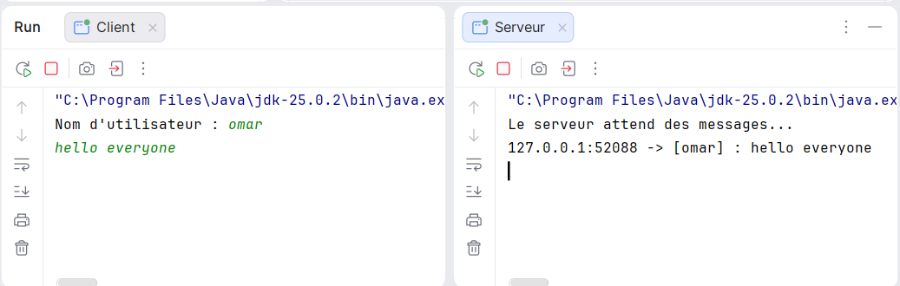
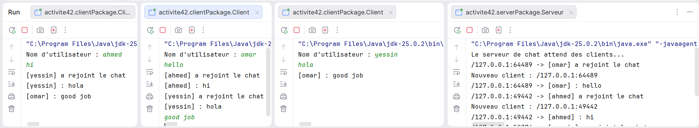

# TP4 - Sockets UDP : service de chat client/serveur

**Matière :** Développement d'applications réparties
**Auditoire :** LSI3
**Étudiant :** Nom Prénom

## Structure du projet

- `src/activite41` : chat unidirectionnel (un client vers le serveur)
- `src/activite42` : chat bidirectionnel avec diffusion à plusieurs clients
- `images` : captures d'écran

## Activité 1 : chat unidirectionnel

Le serveur écoute sur le port 1234 avec un `DatagramSocket` lié par `InetSocketAddress`. Le client demande un nom d'utilisateur puis envoie chaque message sous la forme `[Nom] : texte`. Le serveur affiche l'adresse IP, le port de l'expéditeur et le message reçu.

## Activité 2 : chat avec diffusion

Le serveur garde une liste des adresses (`SocketAddress`) des clients qui ont déjà écrit. À chaque message reçu, il enregistre l'expéditeur s'il est nouveau, puis renvoie le message à tous les autres clients. Le client utilise un thread pour recevoir les messages pendant que le programme principal lit et envoie les siens.

## Synthèse

- UDP fonctionne en mode non connecté : il n'y a pas de connexion à ouvrir, chaque datagramme porte son adresse.
- Le serveur ne peut pas savoir qu'un client est présent tant qu'il n'a rien reçu de lui, d'où la liste construite au fil des messages.
- Un thread de réception est nécessaire côté client, car `receive()` est bloquant et empêcherait sinon de saisir des messages en même temps.
- UDP ne garantit ni l'ordre ni la livraison des messages. En local cela fonctionne bien, mais un message pourrait se perdre sur un réseau chargé.